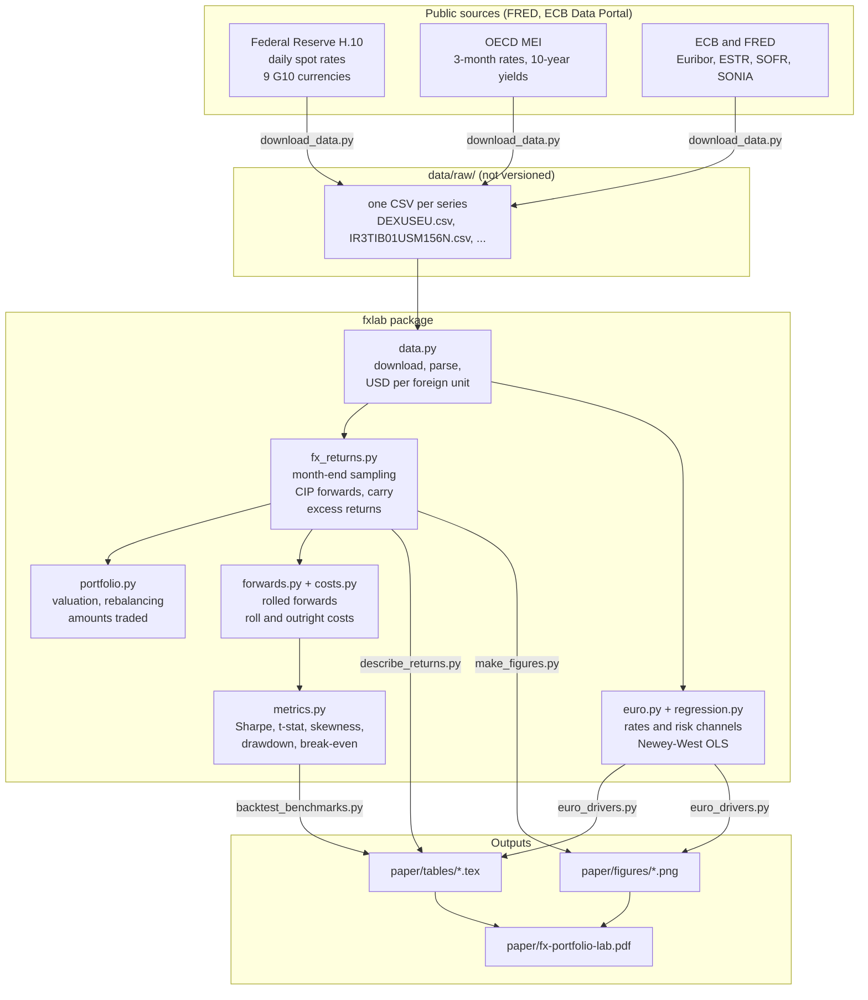
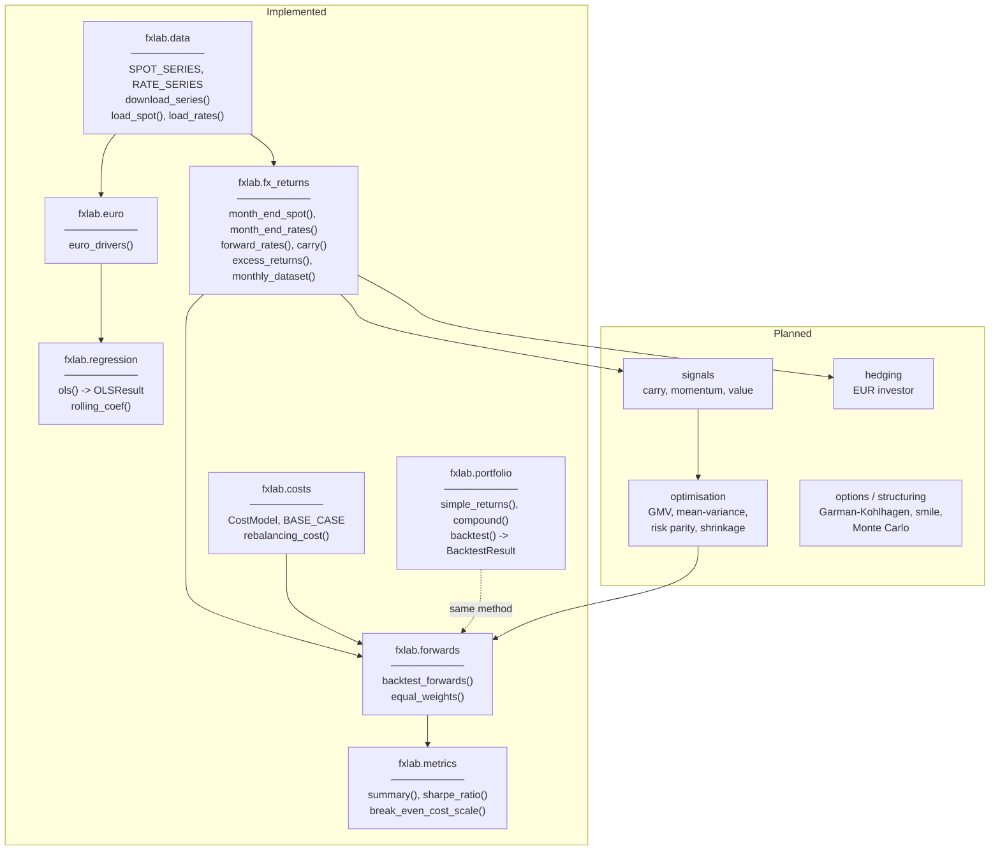
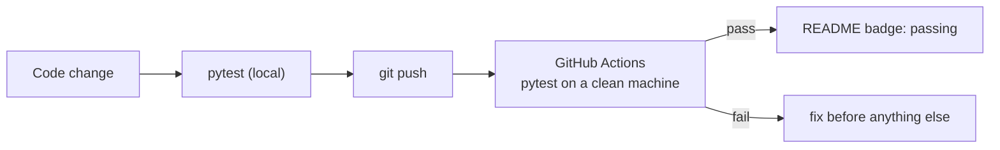

# Architecture - FX Portfolio Lab

**Version:** 0.3 (Phase 1 and euro rates) | **Language:** Python 3.11+ | **Documentation:** [working paper](paper/)

---

## 1. Overview

The project separates three layers that never mix:

1. **Library** (`src/fxlab/`): every calculation lives in a tested Python package. Nothing is computed in a notebook or a script that is not in the library.
2. **Scripts** (`scripts/`): thin entry points that call the library to download data or produce the tables and figures of the paper.
3. **Paper** (`paper/`): the LaTeX working paper. Its tables and figures are *generated* by the scripts and never edited by hand, so the text always matches the code.

Raw data are not versioned: `scripts/download_data.py` rebuilds them from public sources with one command.

---

## 2. Data flow

---

## 3. Modules

| Module | Responsibility | Paper |
|---|---|---|
| `fxlab.data` | Download FRED and ECB series, parse missing values, convert every spot rate to USD per unit of foreign currency, extend rates by splicing | Section 3, D5, D7, D16, D17 |
| `fxlab.fx_returns` | Month-end sampling, CIP forward rates, carry, monthly excess returns with a strict timing rule | Section 4.2, D8-D11 |
| `fxlab.portfolio` | Value buy-and-hold and rebalanced portfolios by propagating amounts; report the amount traded | Section 4.1, D4 |
| `fxlab.forwards` | Value portfolios of rolled one-month forwards: notional weights, collateral, costs, turnover | Section 4.3 |
| `fxlab.costs` | Swap half-spread on the notional rolled, outright half-spread on the notional traded; base case and scaling | Section 4.4, D14, D15 |
| `fxlab.metrics` | Annualised mean and volatility, Sharpe, t-stat, skewness, kurtosis, drawdown, break-even cost scale | Section 4.5 |
| `fxlab.regression` | OLS with Newey-West standard errors, rolling coefficients | Section 6, D18 |
| `fxlab.euro` | Monthly changes of EURUSD and EURCHF and of rate differentials and sovereign spreads | Section 6, D18 |

---

## 4. Conventions

| Item | Convention |
|---|---|
| Spot rate $S_t$ | USD per unit of foreign currency (an increase is an appreciation of the foreign currency) |
| Interest rates | decimal per year (0.05 = 5%), dated at the end of the month they average |
| Returns | simple returns, never log returns, so that $r_p = w'r$ holds exactly |
| Dates | month-end timestamps; $rx_{t+1}$ is indexed at $t+1$ |
| Timing | a position opened at $t$ uses only data available at the end of month $t$ |

---

## 5. Verification

Each test cites the result it reproduces (a course example, a closed-form formula or a timing rule). The full list is in the paper, Appendix B. Tests never use the internet: data loaders are tested on small synthetic files.
