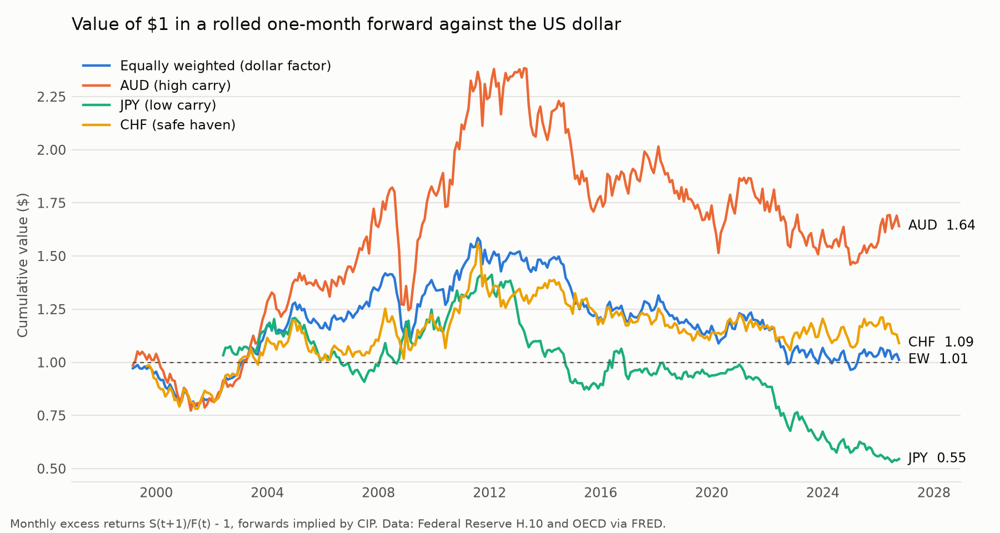

# FX Portfolio Lab

[](https://github.com/tomrousselet/fx-portfolio-lab/actions/workflows/tests.yml)

[](LICENSE)

**From portfolio construction to FX structuring.** A research project that rebuilds, with public data, the analytical work of an FX desk from three angles: the **portfolio manager** who allocates across G10 currencies, the **investor** who hedges the currency risk of foreign assets, and the **structurer** who designs hedging products for corporate clients.

Every result is generated by tested code, and every methodological choice is justified in a working paper ([`paper/`](paper/)) with a decision log.



---

## Key findings so far

*Monthly data, February 1999 - September 2026, US investor, forwards implied by covered interest parity.*

| | Carry (%/yr) | Mean excess return (%/yr) | Volatility (%/yr) | Max drawdown |
|---|---:|---:|---:|---:|
| NZD | +1.8 | +2.7 | 12.6 | 34% |
| AUD | +1.5 | +2.5 | 11.7 | 39% |
| CHF | -1.8 | +0.8 | 9.7 | 32% |
| JPY | -1.7 | -2.1 | 9.3 | 62% |
| Equally weighted (9 currencies) | | +0.4 | **8.1** | 39% |

- **Carry lines up with returns.** High-yielding currencies (NZD, AUD) earned the most, the low-yielding yen the least - the pattern behind the carry trade.
- **Carry has crash risk.** The AUD position lost 32% between June 2008 and January 2009, more than ten years of its average excess return.
- **The Swiss franc is a safe haven.** Negative carry, yet a positive excess return, because it appreciates in bad times.
- **Diversification works, estimation does not.** The equally weighted basket is less volatile than every currency in it, but no mean return is statistically significant (t-stat ≈ Sharpe × √years ≈ 1.15). Volatilities are estimated far more precisely than expected returns - the practical case for minimum-variance allocation.

Full table, methodology and limitations: working paper, Section 3.

---

## Roadmap

| Phase | Content | Status |
|---|---|---|
| 0 | Setup: package, tests, continuous integration, working paper | ✅ done |
| 1 | Engine: FRED data pipeline, currency excess returns, backtester, transaction costs | 🔄 in progress |
| 2 | Currency portfolios: carry, momentum, value; GMV, mean-variance and risk-parity allocation; shrinkage estimators | planned |
| 3 | Optimal currency hedging for a euro-based investor | planned |
| 4 | FX structuring: Garman-Kohlhagen, volatility smile, collars, participating forwards, TARFs | planned |
| 5 | Interactive dashboard, final paper | planned |

---

## Methodology at a glance

| Item | Choice | Why (decision log) |
|---|---|---|
| Frequency | Monthly, month-end spot | Interest rates are monthly; standard in the currency literature (D8) |
| Sample | Unbalanced G10 panel from January 1999 | Uses all available data without inventing any (D9) |
| Base currency | US dollar (EUR investor in Phase 3) | Comparability with published results (D10) |
| Excess return | $rx_{t+1} = S_{t+1}/F_t - 1$, $F_t$ from CIP | Simple returns aggregate exactly: $r_p = w'r$ (D11) |
| Timing | Positions use only data known at the end of month $t$ | No look-ahead bias, enforced by a test |

---

## Repository structure

```
fx-portfolio-lab/
├── src/fxlab/                  # Python package (the library)
│   ├── data.py                 # FRED download, loading, quotation convention
│   ├── fx_returns.py           # month-end sampling, CIP forwards, excess returns, carry
│   └── portfolio.py            # valuation of buy-and-hold and rebalanced portfolios
├── tests/                      # pytest suite: each test cites the result it checks
├── scripts/
│   ├── download_data.py        # downloads every series into data/raw/
│   ├── describe_returns.py     # descriptive statistics -> paper/tables/
│   └── make_figures.py         # figures -> paper/figures/
├── paper/                      # working paper (LaTeX)
│   ├── main.tex
│   ├── sections/               # one file per section, incl. the decision log
│   ├── tables/  figures/       # generated by the scripts, never edited by hand
│   └── Makefile
├── notebooks/                  # exploratory analysis using the package
├── data/raw/                   # downloaded data (not versioned)
├── ARCHITECTURE.md             # data flow and module diagrams
└── pyproject.toml
```

Design and data flow: [`ARCHITECTURE.md`](ARCHITECTURE.md).

---

## Data

All data are public and downloaded by script, so anyone can reproduce the results.

| Data | Source | Frequency |
|---|---|---|
| Spot rates, 9 G10 currencies vs USD | Federal Reserve H.10, via FRED | daily |
| 3-month interbank rates, 10 currencies | OECD Main Economic Indicators, via FRED | monthly |
| Forward rates | implied by covered interest parity | monthly |

---

## Getting started

```bash
git clone https://github.com/tomrousselet/fx-portfolio-lab.git
cd fx-portfolio-lab
python3 -m venv .venv
source .venv/bin/activate
pip install -e ".[dev]"

pytest                                  # run the test suite
python scripts/download_data.py         # download the data (~20 s)
python scripts/describe_returns.py      # statistics table
python scripts/make_figures.py          # figures
make -C paper                           # build the paper (requires a TeX distribution)
```

---

## Verification

The code is checked against independent results before it is used:

- **Course worked examples** (portfolio valuation, rebalancing, compounding) reproduced to the cent.
- **Closed-form checks** of the CIP forward, excess return and carry.
- **Timing tests**: an excess return must not change when later data change (no look-ahead).
- **Data tests**: quotation conventions and missing values, on synthetic files.

The suite runs automatically on every push (GitHub Actions). The list of tests and what each one checks is in the paper, Appendix B.

---

## Tech stack

| Layer | Technology |
|---|---|
| Language | Python 3.11+ |
| Numerical computing | NumPy, pandas, SciPy |
| Visualisation | Matplotlib |
| Testing / CI | pytest, GitHub Actions |
| Documentation | LaTeX working paper |
| Data | FRED (Federal Reserve, OECD) |

---

## References

Main references (full list in the paper): Markowitz (1952); DeMiguel, Garlappi and Uppal (2009); Lustig, Roussanov and Verdelhan (2011); Menkhoff, Sarno, Schmeling and Schrimpf (2012); Campbell, Serfaty-de Medeiros and Viceira (2010); Du, Tepper and Verdelhan (2018); Garman and Kohlhagen (1983).

---

## Author

**Tom Rousselet** - EDHEC Business School  
[tom.rousselet@edhec.com](mailto:tom.rousselet@edhec.com) · [github.com/tomrousselet](https://github.com/tomrousselet)

*This project is for educational and research purposes. It is not investment advice.*
